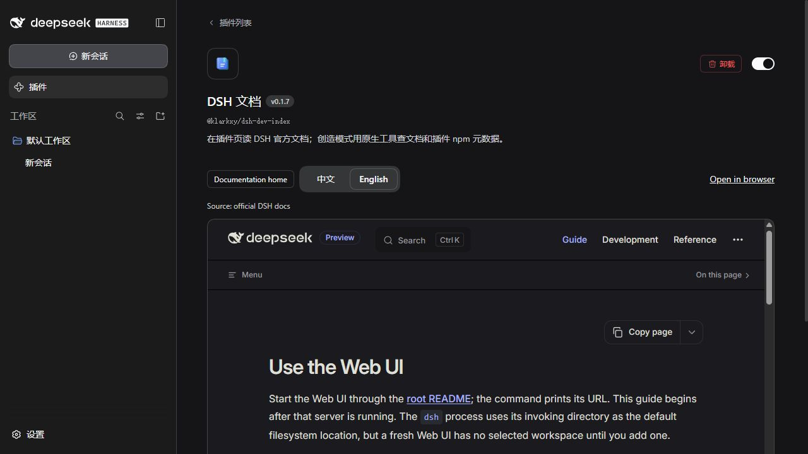

# DSH Docs

<!-- release-state-note -->

[简体中文](README.md) / English

Browse the official DeepSeek Harness developer documentation inside DSH; in Creator mode the agent also gets two read-only tools to search docs and inspect plugins before installing them.

## Demo



## Downloads

[](https://www.npmjs.com/package/@klarkxy/dsh-dev-index)

## Install

```sh
dsh plugin --profile web add @klarkxy/dsh-dev-index
```

Replace `web` with your profile name and restart the profile.

## Usage

### In-App Documentation Browser

Open **Plugins → DSH Docs** to read the [official DeepSeek Harness documentation site](https://deepseek-harness.github.io/deepseek-harness/) inside DSH, complete with a Chinese / English switch, documentation home button, and an option to open in your browser.

### Agent Tools (Creator Mode Only)

In Creator mode the agent receives these read-only tools; other modes never register them:

| Tool | Purpose |
| --- | --- |
| `dsh_docs` | Search the official docs index by title, category, or path (`search`), and fetch document sections by ID (`fetch`). |
| `dsh_plugins` | Search candidate plugins from the klarkxy catalog, npm, or GitHub (`search`), read exact npm metadata and versions (`fetch_npm`), or inspect a GitHub repository and pin a ref to an exact commit spec (`fetch_github`). |

The same mode also prompts the agent to verify APIs via `dsh_docs` and inspect runtime Service, Event, Slot, and Tool contracts with `cordis_inspect_list` and `cordis_inspect_query`.

## Limitations

- Both tools are Creator-mode only and strictly read-only; installing and removing plugins stays with the DSH plugin manager.
- The documentation website tracks the latest DSH release and may differ from the version you run locally.
- npm and GitHub metadata reflect declared package or repository details, not runtime compatibility proof; verify host and dependency compatibility before use.
- GitHub queries use your local signed-in `gh` CLI when available and fall back to anonymous GitHub API requests (subject to hourly rate limits) for repo search and metadata; the plugin stores zero GitHub credentials. Code search for `dsh.plugin.json` manifests (`github-code`) requires a signed-in `gh` CLI.
- Cancelling the last request using the `gh` CLI waits for that check to stop; unloading the plugin waits for active GitHub requests and CLI processes to exit.

## Install from GitHub

```sh
dsh plugin --profile web add "github:klarkxy/dsh-plugins#path:/plugins/dsh-dev-index"
```

A GitHub install runs a local build, so pnpm first asks you to allow build scripts. Add the following to `$DSH_HOME/profiles/web/pnpm-workspace.yaml`, then run the install command again:

```yaml
allowBuilds:
  '@klarkxy/dsh-dev-index': true
```

## License

[SATA License 2.1](LICENSE)
