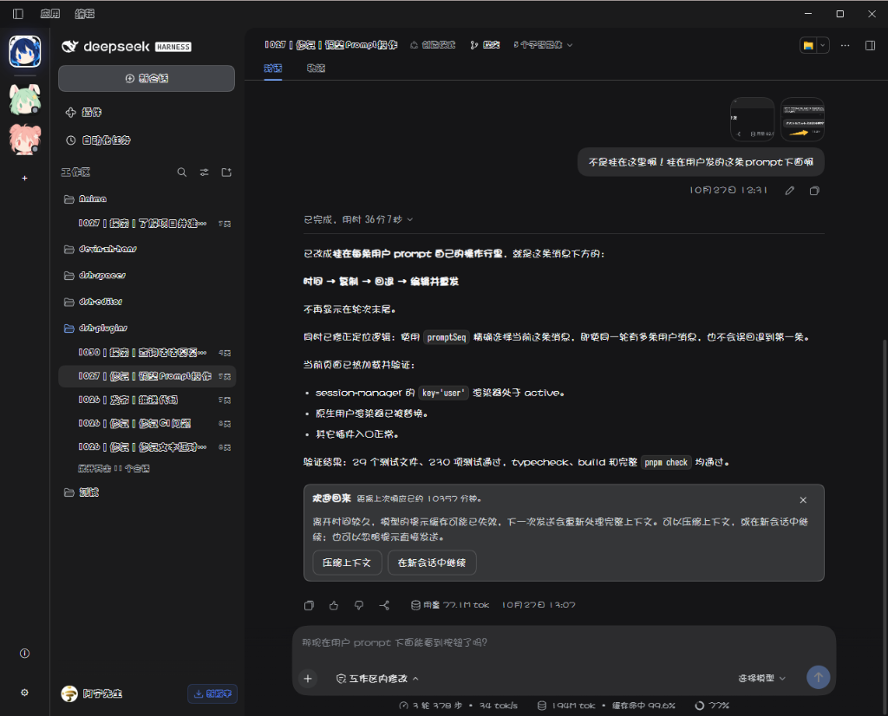

# Font

<!-- release-state-note -->

[简体中文](README.md) / English

Customize the interface, conversation, code and terminal fonts and font sizes of the DeepSeek Harness Web GUI.



## Install

```sh
dsh plugin --profile web add @klarkxy/dsh-font
```

Replace `web` with your profile name, then restart the profile or reload the page.

## Usage

After installing and enabling the plugin, open **Settings → Font**. While it is active, the native **Font size** row in **Settings → General** is hidden so all typography controls live in one place; disabling or uninstalling the plugin restores the native row.

- **Interface font**: applies to all interface text, including the conversation while **Conversation font** follows it. Pick a preset, choose an installed system font, or select **Custom…** to enter a full `font-family` stack (leave empty to restore the default).
- **Conversation font** and **Font size**: sets a separate font for conversation messages and the input box (defaults to **Same as interface font**, useful for reading long text in a serif face) along with the conversation text size.
- **Code font** and **Code font size**: applies to code blocks, inline code, and tool output.
- **Terminal font** and **Terminal font size**: applies to the sidebar terminal, independent of the code font.
- **System font picker**: click **Load system fonts** (which becomes **Reload system fonts** once loaded) to choose from fonts installed on this computer, or reload after installing new fonts.
- **Sync and reset**: changes apply immediately and stay in sync with DSH settings, including desktop `Ctrl/⌘±` font-size shortcuts (adjusting all three sizes together). Select **Default** to restore an individual font; **Reset fonts** resets all font choices without touching sizes, and **Reset font sizes** restores all three default sizes without touching fonts.

## Limitations

- **Browser support**: **Load system fonts** is supported only in Chromium-based browsers and prompts for permission. Browser enumeration may omit fonts installed only for the current user; you can still type any font name manually under **Custom…**.
- **Persistence and devices**: interface, code, and terminal fonts plus all font sizes are saved by DSH; the conversation font is saved in the current browser only. Every machine where you open the GUI must have the chosen fonts installed.
- **No bundled font files**: the plugin uses fonts already installed on your computer and bundles no font files of its own.

## License

[SATA License 2.1](LICENSE)
