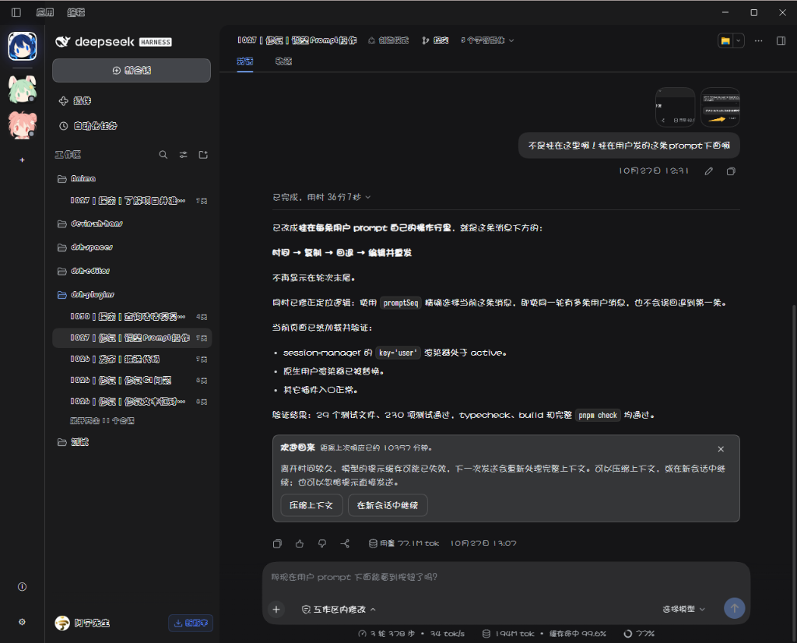

# 字体

<!-- release-state-note -->

简体中文 / [English](README.en.md)

自定义 DeepSeek Harness Web GUI 的界面字体、对话字体、代码与终端字体及字号。



## 下载量

[](https://www.npmjs.com/package/@klarkxy/dsh-font)

## 安装

```sh
dsh plugin --profile web add @klarkxy/dsh-font
```

把 `web` 换成你的 profile 名，安装后重启 profile 或刷新页面。

## 使用

安装并启用后，打开 **设置 → 字体**。安装期间，**设置 → 通用** 里的原生「字号大小」行会被收起，同类控件集中在这个页面；停用或卸载插件后，原生行会自动恢复。

- **界面字体**：作用于整个界面的文字；对话字体设为「跟随界面字体」时也会跟随它。可选择预设字体、从本机系统字体中挑选，或选「自定义…」手动输入完整的 `font-family` 字体栈（留空恢复默认）。
- **对话字体**与**字号大小**：单独设置对话区消息和输入框的字体（默认「跟随界面字体」，可单设为衬线体等适合长文阅读的字体），以及会话内容的字号大小。
- **代码字体**与**代码字号**：作用于代码块、行内代码与工具输出。
- **终端字体**与**终端字号**：作用于侧栏终端，与代码字体独立。
- **读取系统字体**：点击「读取系统字体」（加载后变为「重新读取系统字体」）即可在下拉列表中选择本机已安装的字体；新装字体后可点击重新读取刷新列表。
- **同步与重置**：所有改动立即生效并与 DSH 设置同步，包括桌面端 `Ctrl/⌘±` 字号快捷键（同时调整三项字号）。下拉选择「默认」可恢复单项原字体；「恢复默认字体」重置所有字体选择而不改字号，「恢复默认字号」恢复三项默认字号而不改字体。

## 主要限制

- **系统字体权限与范围**：「读取系统字体」仅在 Chromium 系浏览器中可用，首次使用需浏览器授权。浏览器枚举列表可能不包含仅安装到当前用户的字体，此时仍可通过「自定义…」手动输入字体名使用。
- **存储与跨设备**：界面、代码、终端字体及全部字号保存在 DSH 设置中；对话字体仅保存在当前浏览器。在不同设备打开界面时，每台设备都需要安装所选字体。
- **不附带字体文件**：插件直接使用本机已安装的字体，本身不附带任何字体文件。

## 许可证

[SATA License 2.1](LICENSE)
