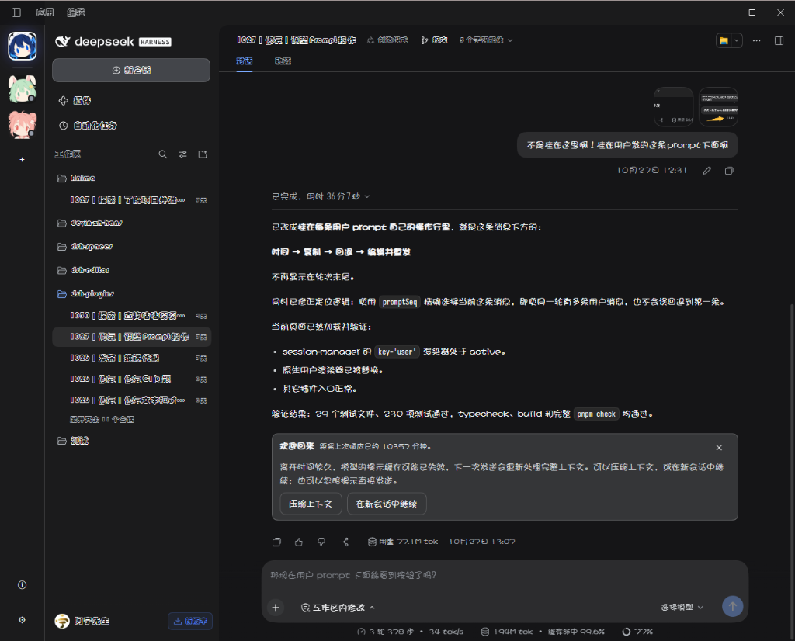

# Font

<!-- release-state-note -->

[简体中文](docs/README.zh-CN.md)

Customize the interface, conversation, and code fonts and the conversation font size of the DeepSeek Harness Web GUI.



## Install

```sh
dsh plugin --profile web add @klarkxy/dsh-font
```

Replace `web` with your profile name, then restart the profile or reload the page.

## Use

Open **Plugins → Font**:

- **Interface font** and **Code font**: pick a preset, type any font name, or click **Load system fonts** to choose from fonts installed on this computer.
- **Conversation font**: the same choices, applied only to messages and the input box in the conversation — e.g. a serif face for long text. **Same as interface font** keeps it following the interface font.
- **Conversation font size**: 10–22 px, kept in sync with **Settings → General**.

Changes apply immediately and stay in sync with DSH settings. Choose **Default** to return to the DSH font; **Reset all to defaults** resets all three font choices and the conversation size on this page.

Code font applies to code blocks and inline code. Terminal font and size are independent; adjust them in **Settings → General**.

## Limits

- **Load system fonts** is supported in Chromium-based browsers and asks for permission.
- The interface font, code font and conversation size are saved by DSH; the conversation font is saved in the current browser. Every computer where you open the GUI needs the chosen fonts installed.
- The plugin uses fonts already installed on your computer rather than bundling font files.

## License

[SATA License 2.1](LICENSE)
