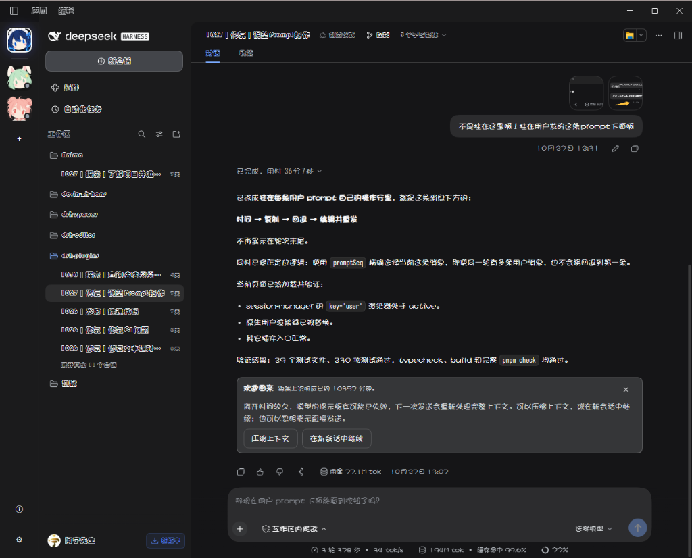

# 字体

<!-- release-state-note -->

[English](../README.md)

自定义 DeepSeek Harness Web GUI 的界面字体、对话字体、代码与终端字体及字号。



## 安装

```sh
dsh plugin --profile web add @klarkxy/dsh-font
```

把 `web` 换成你的 profile 名，安装后重启 profile 或刷新页面。

## 使用

打开「设置 → 字体」——本插件新增的独立分区。安装期间「设置 → 通用」里的原生「字号大小」一行会被收起，同样的控件集中在这一个页面；卸载或停用插件后，原生行自动恢复。

- **界面字体**：选预设、手动输入字体名，或点「读取系统字体」从本机已装字体中选择。
- **对话字体**和**字号大小**：对话区独立的字体（选「跟随界面字体」则沿用界面字体）与会话内容字号。
- **代码字体**和**代码字号**：作用于代码块、行内代码与工具输出。
- **终端字体**和**终端字号**：作用于侧栏终端，与代码字体独立。

改动立即生效，并与 DSH 设置保持同步——包括桌面端 Ctrl/⌘± 字号快捷键（同时调整三项字号）。选择「默认」可恢复 DSH 原字体；「恢复默认字体」重置所有字体选择、不影响字号；「恢复默认字号」恢复三项字号默认、不影响字体。

## 限制

- 「读取系统字体」在 Chromium 系浏览器中可用，首次使用需浏览器授权。
- 界面、代码、终端字体与全部字号由 DSH 保存；对话字体仅保存在当前浏览器。在不同电脑打开界面时，每台电脑都需安装所选字体。
- 插件直接使用本机已安装的字体，本身不附带任何字体文件。

## 许可证

[SATA License 2.1](../LICENSE)
